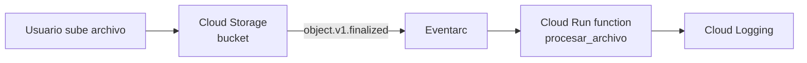

# GCP_Config_TuringIA_Trial

Práctica en GCP: un bucket de Cloud Storage con reglas de ciclo de vida y una Cloud Function en Python que se activa al subir un archivo, extrae sus metadatos y los registra en Cloud Logging.

## Diagrama del flujo

## Archivos del repositorio
- [main.py](./main.py): código de la función
- [requirements.txt](./requirements.txt): dependencias
- [test_main.py](./test_main.py): pruebas unitarias

## Creando un proyecto nuevo en GCP
- Damos click en crear nuevo proyecto y le damos nombre

- Añadimos las API necesarias, en este caso empezamos con Cloud Storage, Cloud Functions, Cloud Pub/Sub, Cloud Logging y Cloud Build
- Entramos a la pestaña de IAM y administración
- Creamos un usuario con privilegios mínimos, en este caso de visualizador

- Si el rol se otorga a nivel de proyecto, la cuenta hereda los permisos de visualización a los buckets
- Como mejora, lo ideal sería usar una cuenta de servicio con el rol `roles/storage.objectViewer` solo sobre el bucket

## Creando el Bucket de prueba
- Entramos a la pestaña de buckets
- Creamos el bucket y le damos nombre
- Seleccionamos por región y dejamos la default
- Dejamos el modo Standard
- El control de acceso queda en Uniforme
- La protección de datos queda en predeterminada
- La configuración del bucket quedaría así:

## Creando el ciclo de vida del bucket
- Entramos al bucket y abrimos la pestaña Lifecycle
- Creamos una regla que pase los archivos en Standard con más de 30 días a Nearline
- Creamos una regla que pase los archivos con más de 90 días a Coldline
- Creamos una regla que elimine los archivos con más de un año
- Creamos una regla que elimine las subidas multipart incompletas después de 7 días

### Justificación
El supuesto es que los archivos se consultan con mucha frecuencia justo después de subirse, y su uso disminuye con el tiempo:

- **0-30 días (Standard):** acceso frecuente. Es la clase con mayor costo de almacenamiento pero sin cargos por lectura.
- **30-90 días (Nearline):** acceso ocasional. Almacenar es más barato, pero leer tiene un costo adicional.
- **90-365 días (Coldline):** acceso muy raro. Es aún más barato almacenar.
- **365 días:** los archivos se eliminan para no pagar por datos que ya no se necesitan (retención de 1 año).
- **Subidas incompletas (7 días):** evita pagar por fragmentos de subidas fallidas.

### Notas
- Los valores de 30, 90 y 365 días son un ejemplo. En un caso real se ajustarían según el patrón de acceso y los requisitos de retención de cada tipo de dato.
- Nearline y Coldline tienen una duración mínima de almacenamiento (30 y 90 días), por eso las reglas se encadenan con esos intervalos.
- GCP evalúa estas reglas de forma asíncrona (aprox. una vez al día), por lo que los cambios no son inmediatos.

## Creando la Cloud Function
- Nos vamos a la pestaña de Cloud Run
- En el apartado de escribir función elegimos Python
- Le damos nombre al servicio
- Dejamos la autenticación en "Requerir autenticación", ya que solo Eventarc invoca la función, no usuarios
- Añadimos el activador de Cloud Storage y seleccionamos el bucket
- Verificamos que el tipo de evento sea `google.cloud.storage.object.v1.finalized`
- Nota: si la lista de proveedores sale incompleta o no aparece `finalized`, hay que habilitar la API de Cloud Build y recargar
- Seleccionamos la cuenta de servicio default, aunque la mejor práctica sería crear una con los permisos mínimos
- Quedaría de la siguiente manera la configuración:

- Damos click en crear para que abra el editor
- Modificamos el `main.py` para que sea el de [main.py](./main.py)
- Agregamos las dependencias de [requirements.txt](./requirements.txt)
- Modificamos el punto de entrada a `procesar_archivo` para que coincida con el código
- Subimos un archivo al bucket

- Verificamos en el Explorador de registros que el servicio funcionó

### Qué hace el código
- Se activa con cada archivo subido al bucket
- Extrae nombre, bucket, tamaño, tipo de contenido, clase de almacenamiento y fecha de creación
- Escribe logs estructurados en JSON que Cloud Logging puede filtrar por severidad
- Los eventos inválidos se registran como `ERROR` y los errores inesperados como `CRITICAL`

## Pruebas unitarias
- Las pruebas están en [test_main.py](./test_main.py) y se ejecutan de forma local, no dentro de GCP
- Instalamos las dependencias: `python -m pip install functions-framework pytest`
- Ejecutamos las pruebas desde la carpeta del proyecto: `python -m pytest -v`
- Se prueba el flujo exitoso (metadatos correctos, valores por defecto y log de éxito)
- Se prueba el manejo de errores (sin nombre, sin bucket, datos que no son diccionario y evento inválido)
